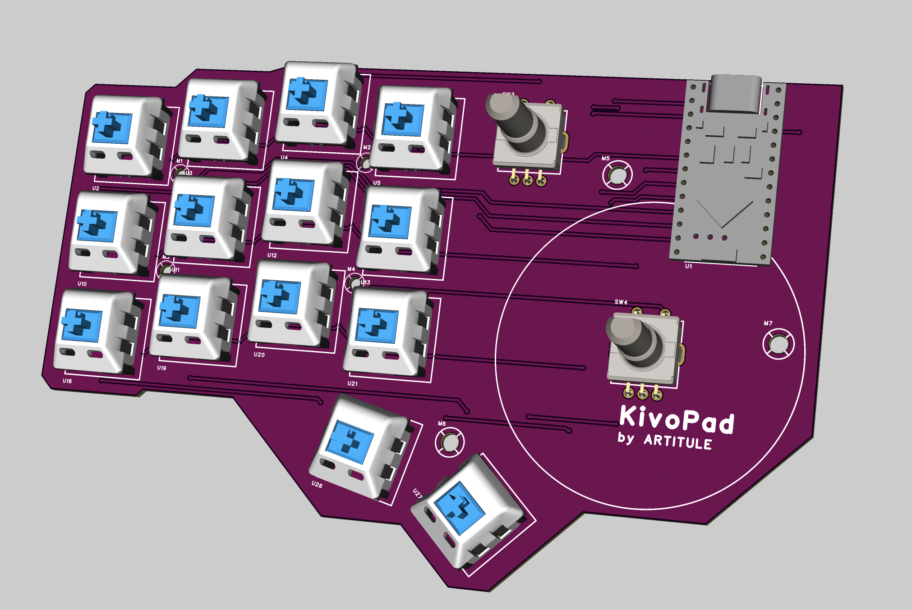
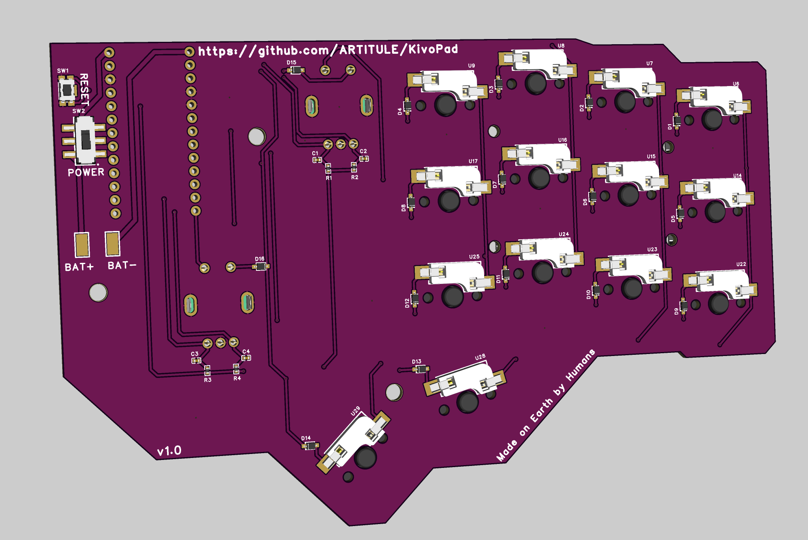
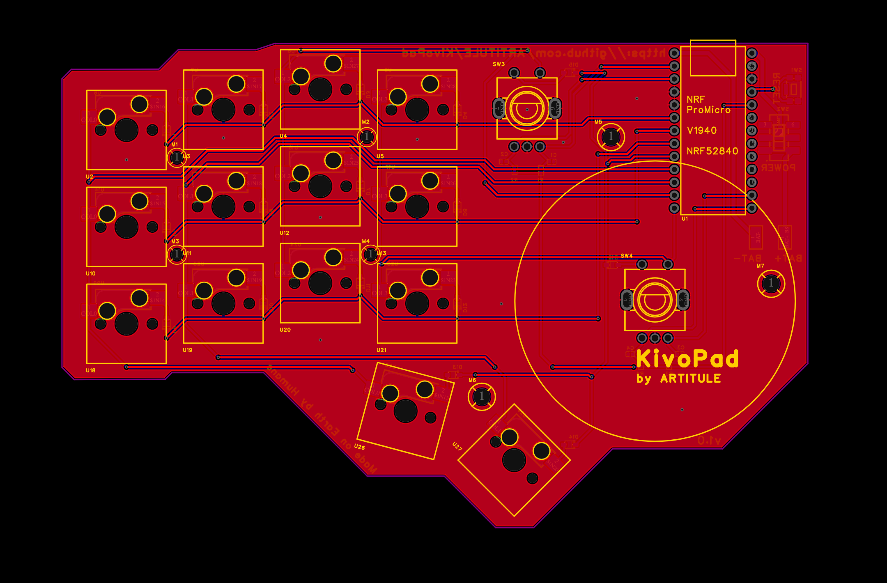
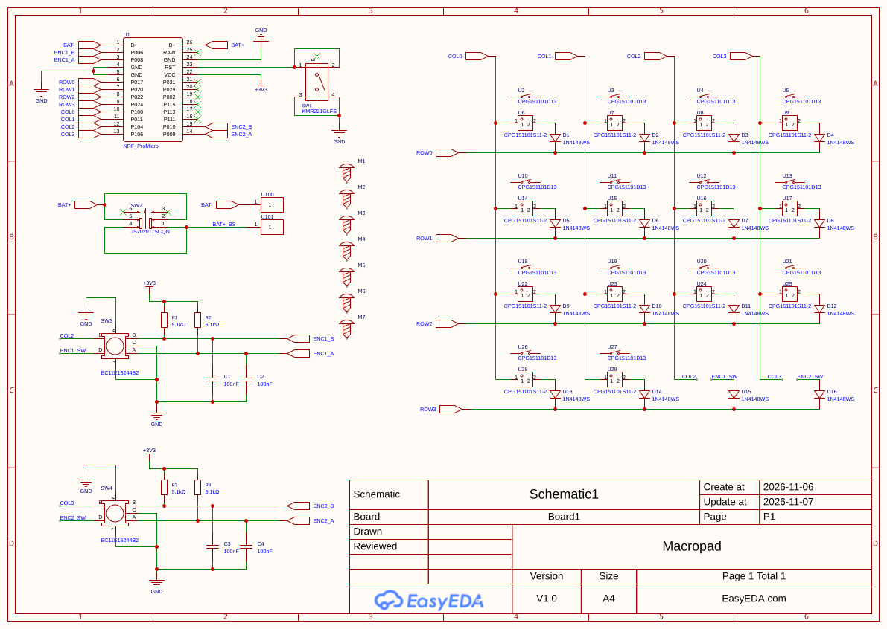
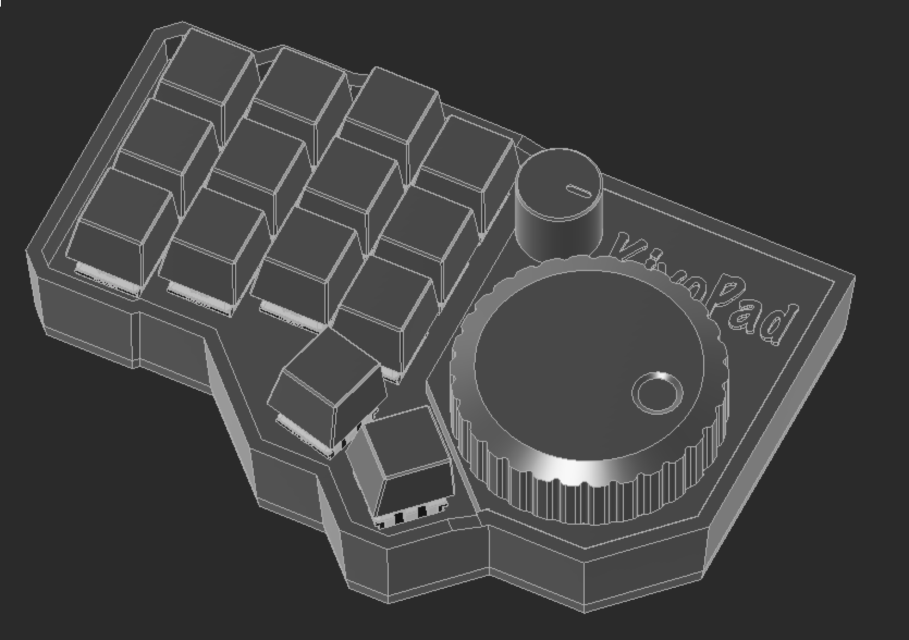

# KivoPad

KivoPad is a custom macropad running on ZMK firmware featuring 14 mechanical switches with hot-swap sockets and  2 encoders. The switches can be programmed to any action and thanks to ZMK the whole macropad is wireless.

The keyboard uses a cheap NRF ProMicro board with the NRF52840 ic. This board is pin compatible with the NiceNano v2 and is running with the same ic.

This project was made as a part of my week 5 submission to Half Life.

|             Front Picture               |             Back Picture              |
|-----------------------------------------|---------------------------------------|
|||

## PCB Design

The PCB is a 2 Layer board. The front houses the switches, the encoders and the NFR ProMicro microcontroller. The back side has the diodes and the hot-swap sockets.

All of the PCB files can be found in the [PCB_Files](/PCB_FIles/) folder. There you can also find the BOM for the PCB.

For anyone interested here is the schematic:

## 3D Case

You can find all of the KivoPad Case files in the [3D_Files](/3D_Files/) folder. Any Cherry MX compatible keycaps will work, even 3D printed ones.

## Firmware Installation

Note: The keybindings defined in the firmware are just there for testing purposes, you can use the ZMK Studio website to create your desired keybindings. See [Changing The Keybindings](#changing-the-keybindings) for more info.

1. Download the latest firmware file created by Github Actions.
2. Unzip the file. (You should get a .uf2 file)
3. Connect the KivoPad with a USB cable to your PC.
4. Press the RESET button on the PCB.
5. A new drive named "Nice Nano" should pop up. Drag the firmware file that you unzipped into the drive.
6. That's it the drive should auto eject once the transfer is completed. Connect to your KivoPad via Bluetooth and enjoy.

## Changing The Keybindings

Once the firmware is flashed you get a default set of keybindings. To change them navigete to [ZMK Studio](https://zmk.studio/) and connect your KivoPad. You will be prompted for you to unlock your keyboard. The keyboard unlock button is the second encoder button.

## BOM

Please note that some of the parts on LCSC have a minimum ordering quantity.

|Item                                                            |Qty|Supplier|Cost/item        |Total Cost|link                                                    |
|----------------------------------------------------------------|---|--------|-----------------|----------|--------------------------------------------------------|
|PCB                                                             |1  |JLCPCB  |$10.80           |$10.80    |[JLCPCB](https://jlcpcb.com/)                           |
|Components from LSCS(Please upload the PCB BOM to their website)|1  |LSCS    |$10.75(Estimated)|$10.75    |[LCSC](https://www.lcsc.com)                            |
|500mAh Battery                                                  |1  |Amazon  |$8.99            |$8.99     |[Amazon](https://www.amazon.com/dp/B0CNLN7F24?_encoding=UTF8&th=1)|
|NRF ProMicro                                                    |1  |Amazon  |$7.99            |$7.99     |[Amazon](https://www.amazon.com/NRF52840-Development-Bluetooth-Wireless-Electronics/dp/B0GSZ7FD6T?crid=28RUQAMFK7QT&dib=eyJ2IjoiMSJ9.GWqFJJiGzPOkrPepnTW2lg0pKNpktU-gSLKc1_Ol_DiJiCMFsY3ptQin8xmzcyVmzBP6vw3q7lq2BLuM6pd1Re0Sm8vf3-ntIHdseWcDm_J9-y97sNE2W_M1EGpSsGQA0I3fdi4X4wzkXUPc2N7chNvlcFz30ovYs32drentfmamaVW2p8rHEmWKn-y1dN6axAHIjgqZnuNgHV6PRnLASYTqnfzWHgj3WK2OousnZhc.e4BAtEWwEBqlHYGfbpeY_3F9Lf-DXQJkWgH1FxNQJuk&dib_tag=se&keywords=nrf%2Bpro%2Bmicro&qid=1794163024&sprefix=nrf%2Bpr%2Caps%2C346&sr=8-4&th=1)|
|Estimated total shipping                                        |1  |        |                 |$10.00    |                                                        |
|Estimated TOTAL                                                 |   |        |                 |$40.54    |                                                        |
